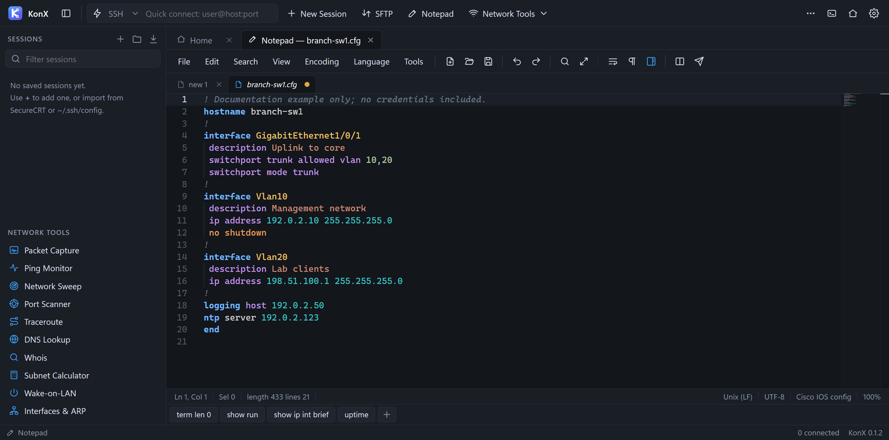

# KonX

**A Windows desktop workspace for terminals, file transfers, configuration editing, packet analysis, and network troubleshooting.**

Connect to a switch, move files over SFTP, edit its configuration, and investigate the network from the same tabbed application. KonX combines an SSH/Telnet/serial terminal, a two-pane file manager, a Monaco-based editor, a packet capture viewer, and practical network tools.

[Download the latest release](https://github.com/256kMagic/KonX/releases/latest) · [User guide](docs/USER_GUIDE.md) · [Report an issue](https://github.com/256kMagic/KonX/issues)

## Download and install

The current release is **0.2.0**, built and tested for **Windows x64**. Node.js is only needed when running from source.

| Download | Use it for |
| --- | --- |
| [KonX-Setup-0.2.0.exe](https://github.com/256kMagic/KonX/releases/download/v0.2.0/KonX-Setup-0.2.0.exe) | A per-user installation with Start menu and desktop shortcuts, an uninstaller, and a choice of installation folder. |
| [KonX-0.2.0-portable.exe](https://github.com/256kMagic/KonX/releases/download/v0.2.0/KonX-0.2.0-portable.exe) | Run without installing, including from a USB drive. Application settings are still stored in the Windows user profile. |
| [SHA256SUMS.txt](https://github.com/256kMagic/KonX/releases/download/v0.2.0/SHA256SUMS.txt) | SHA-256 checksums for the release files. |
| [SIP sample capture](https://github.com/256kMagic/KonX/releases/download/v0.2.0/sip-demo.pcapng) | Three synthetic calls for trying the ladder, SDP details, and call exports. |

1. Download the installer or portable executable from the release above.
2. Run it and open KonX. The standard per-user installation does not require administrator rights.
3. Choose **Quick Connect**, or press **Alt+Q**, to open your first connection.

The current executables are unsigned. Windows SmartScreen may show an unrecognized-app warning. Verify that the download came from this repository's release and check its checksum before deciding whether to run it.

To calculate a downloaded file's checksum in PowerShell:

~~~powershell
Get-FileHash .\KonX-Setup-0.2.0.exe -Algorithm SHA256
~~~

Compare the hash with `SHA256SUMS.txt`. For an update, save your documents and close KonX before running the newer installer. Updates are installed manually; KonX does not currently provide an automatic updater.

## What's new in 0.2.0

- **Packet reassembly and readable traffic:** sequence-aware TCP reconstruction, distinct UDP datagrams, gap and conflicting-overlap warnings, and links back to source packets. The HTTP/1 view pairs requests and responses when supported by the capture, handles chunked and gzip/deflate bodies, formats JSON, and exports complete decoded bodies.
- **SIP call analysis:** searchable call list, clickable signaling ladder, observed SDP media details, and PCAPNG/JSON call exports. Calls can span proxy legs, and retransmissions, dialog branches, incomplete evidence, and analysis limits stay visible.
- **Stable dialogs:** switching session panels keeps the header and navigation in place, with long content scrolling inside the dialog.
- **Accurate Auto-scroll:** scrolling upward or using packet-navigation keys pauses following and clears the checkbox; checking it again resumes following.
- **Reachable tabs:** overflowing application tabs have arrow controls and a **Show all tabs** menu. Background activity preserves manual tab scrolling.
- **Clearer toolbar:** the button-bar toggle has a dedicated icon and Show/Hide label, and Quick Connect uses the same dropdown styling as other forms.
- **Consistent version reporting:** the development app reports the KonX package version in its status bar.

See the [release notes](CHANGELOG.md) and [user guide](docs/USER_GUIDE.md) for workflows and limitations. To try SIP immediately, open the downloadable sample in **Packet Capture** and click **SIP Calls**.

## Start working

- **Connect:** use Quick Connect for SSH, Telnet, raw TCP, or serial, then save frequently used connections in the session sidebar.
- **Transfer:** open SFTP from a saved SSH session or an existing SSH tab to work with local and remote files side by side.
- **Edit:** open Notepad for local documents, remote SFTP files, configuration cleanup, file hashing, or document comparison.
- **Investigate:** open Packet Capture to record traffic or inspect an existing capture, or choose a network tool from the home screen.
- **Assess security (development source):** open Security Suite for Windows posture and remote exposure, TLS/SSH, web headers, device configuration, and saved-capture checks. Review evidence, compare local baselines, and export JSON/HTML reports. See the [Security Suite guide](docs/SECURITY_SUITE.md) for scope and workflows; these tools are not included in the published 0.2.0 executables.
- **Wireless and Mist (development source):** inspect local Wi-Fi adapters, cached BSSIDs, signal and channels, or save an encrypted Mist token for AP/client monitoring and direct Marvis troubleshooting. See the [Wi-Fi and Mist guide](docs/WIRELESS_MIST_GUIDE.md).

The [user guide](docs/USER_GUIDE.md) covers connection settings, credentials, imports, transfers, editing, capture filters, and troubleshooting in detail.

## What KonX includes

### Terminal and session manager

- SSH2, Telnet, raw TCP, and serial COM-port connections in tabs.
- Nested session folders, search, duplication, drag-to-folder, and connecting a whole folder.
- Imports from SecureCRT session folders and OpenSSH `config` files, including ProxyJump.
- SSH host-key verification and warnings when a saved key changes.
- Password, private-key/passphrase, SSH-agent, and keyboard-interactive authentication.
- Jump hosts and local, remote, and dynamic SOCKS5 forwarding.
- Logon actions, Telnet auto-login, timestamped session logs, and filename templates.
- A programmable button bar and a command window that can send to one or multiple sessions.
- Scrollback search, copy-on-select, multiline-paste confirmation, zoom, color schemes, and serial/Telnet Break.

### SFTP file manager

- Local and remote panes, including SFTP alongside an active SSH connection.
- Drag-and-drop transfers, recursive folders, and a queue with progress, speed, and cancellation.
- Existing-file choices: ask, overwrite, skip, or overwrite if newer.
- Rename, delete, new folder, remote permissions, timestamps, and hidden-file controls.
- Remote editing with the system's default application and upload when the local copy changes.

SFTP opened from an active SSH tab shares that tab's connection. Closing or disconnecting the SSH tab also closes its SFTP connection.

### Notepad and configuration editing

- Monaco-based document tabs, restored editing sessions, and backups of unsaved documents.
- Syntax highlighting, including Cisco IOS/IOS-XE/NX-OS configuration and log-file patterns.
- Multiple cursors, column editing, regex find/replace, Find in Files, folding, a minimap, and document comparison.
- UTF-8, UTF-8 BOM, UTF-16 LE/BE, and ANSI; CRLF, LF, and CR line endings.
- Line sorting, IP-address sorting, duplicate/empty-line removal, trimming, joining, case conversion, and indentation tools.
- JSON/XML formatting, Base64/URL/hex conversion, text/file hashes, and firmware checksum verification.
- IP/MAC extraction and configuration sanitizing to help remove recognized passwords and keys. Review sanitized output before sharing it.
- Remote SFTP editing, opening terminal scrollback as a document, and sending configuration lines to a terminal with a configurable delay.

### Packet capture and analysis

- Live capture through Windows' built-in ETW/NDIS capture engine; Npcap is an optional additional engine when its driver is installed.
- Open/save `.pcap` and `.pcapng`, and open supported Windows NDIS `.etl` traces.
- Protocol decoding across common Ethernet, IP, transport, discovery, routing, management, and application protocols.
- Packet summaries, a detail tree linked to hex bytes, TCP analysis, and TCP/UDP stream following.
- Readable HTTP/1 request/response pairs reconstructed across packets, searchable headers and text, formatted JSON, chunked bodies, gzip/deflate decoding, and saving complete decoded bodies.
- **SIP Calls** lists plaintext SIP calls across captured UDP/TCP conversations, draws signaling ladders, shows observed SDP details, and exports call signaling as PCAPNG or JSON.
- Explicit missing-byte boundaries and conflicting retransmissions, with source-packet links from reconstructed messages.
- Conversations, endpoints, protocol hierarchy, throughput, and names learned from captured DNS answers.
- Insights for conditions such as DHCP conflicts, duplicate IPs, cleartext authentication, retransmissions, failed DNS requests, connection failures, and selected network redundancy problems.
- CDP/LLDP neighbor cards showing switch, port, VLAN, and management information when those packets are available.
- Display filters with familiar expressions such as `ip.addr == 10.0.0.1 && tcp.port == 443`, plus shorthand such as `host 10.0.0.1`, `port 443`, and `retrans`.

The SIP view inspects captured signaling and advertised media settings. It does not decrypt SIP over TLS or SRTP, reconstruct RTP audio, or provide audio playback. Call exports retain original signaling packets; a shared TCP packet can also contain another call's messages. See [SIP calls and signaling ladders](docs/USER_GUIDE.md#sip-calls-and-signaling-ladders) for the workflow and export details.

#### Capture engines and permissions

| Engine | Requirements | Behavior |
| --- | --- | --- |
| Windows built-in | Included with Windows; no extra capture driver installation. | Starting a live capture requests administrator permission through UAC. Capture filters are applied as packets arrive. Loopback capture is unavailable. |
| Npcap, optional | A separately installed Npcap driver. | Supports BPF capture filters and loopback. Permissions depend on the Npcap installation, including whether it restricts access to administrators. |

The built-in engine uses an elevated capture helper connected through a token-authenticated named pipe. Stopping capture or closing KonX stops its capture session. Reading an existing capture file does not require elevation.

Npcap is not bundled with KonX. Its own [installation and license terms](https://npcap.com/) apply. Windows `pktmon` ETL files use a different format and are not supported by the current ETL importer. See the [capture instructions](docs/USER_GUIDE.md) for engine selection and filters.

### Network tools

- **Ping monitor:** multiple hosts, loss, latency, jitter, history, and CSV export.
- **Network sweep:** CIDR/ranges/lists, reverse DNS, ARP MAC addresses, and TCP fallback.
- **Port scanner:** presets, banners, TLS certificate information, and open/closed/filtered results.
- **Traceroute, DNS lookup, whois, IPv4/IPv6 subnet calculator, Wake-on-LAN, local interfaces, and ARP cache.**
- Context actions connect tool results to terminals, SFTP, browsers, other tools, and packet capture.

## Keyboard shortcuts

| Shortcut | Action |
| --- | --- |
| Alt+Q | Quick Connect |
| Alt+1 through Alt+9 | Switch tabs |
| Ctrl+Tab / Ctrl+Shift+Tab | Next / previous tab |
| Ctrl+Shift+W or Ctrl+F4 | Close the active tab |
| Ctrl+Shift+C / Ctrl+Shift+V | Terminal copy / paste |
| Ctrl+Insert / Shift+Insert | Alternative terminal copy / paste |
| Ctrl+Shift+F | Find in terminal scrollback |
| Ctrl+= / Ctrl+- / Ctrl+0 | Terminal zoom in / out / reset |
| F12 | Developer tools |

Editor-specific commands and shortcuts are described in the [user guide](docs/USER_GUIDE.md).

## Data and credentials

KonX stores its application data under `%APPDATA%\KonX`, including:

- `sessions.json`: saved connection settings and encrypted password/passphrase fields.
- `settings.json`: application preferences.
- `known_hosts.json`: trusted SSH host keys.
- `notepad\`: editor session data and document backups.

Saved passwords and private-key passphrases use Electron `safeStorage`, backed by Windows DPAPI. The session-list UI receives flags indicating whether a secret is present, rather than the stored secret. If encryption is unavailable, new password/passphrase values are not persisted; the store does not fall back to saving them as plaintext.

Other session metadata, settings, editor backups, terminal logs, and capture files are ordinary files. Protect them as you would the original configurations and traffic. DPAPI-protected credentials are tied to the Windows account/environment; copying the profile folder is not a portable credential export. Keep private keys and device credentials out of GitHub issues and pull requests.

## Run from source

Use **Windows x64**, **Node.js 22.12 or newer**, npm, and Git. Other operating systems and architectures are not currently release targets.

~~~powershell
git clone https://github.com/256kMagic/KonX.git
cd KonX
npm ci
npm start
~~~

Dependencies and packaged output are excluded from Git. `npm ci` installs the versions in `package-lock.json`. If your npm configuration blocks Electron's installation script and Electron reports that it did not install correctly, run:

~~~powershell
node node_modules/electron/install.js
~~~

Then retry `npm start`. Serial support depends on the optional `serialport` package and its native binding loading successfully.

### Build the Windows executables

~~~powershell
npm run dist
~~~

The build creates versioned executables under `dist/`, such as `KonX-Setup-0.2.1.exe` and `KonX-0.2.1-portable.exe` for the current source version. `npm run dist:dir` creates the unpacked Windows application for inspection. Published release executables are attached to [GitHub Releases](https://github.com/256kMagic/KonX/releases); they are not checked into the source tree.

### Test and try a local device

~~~powershell
npm test
~~~

The automated suite covers connections, host-key/authentication handling, SFTP, session storage/imports, network tools, packet decoding/filtering/analysis, capture files, and editor operations. Regression checks also cover download cancellation and original-file preservation, editor reload/save recovery, prompt handling, capture-file isolation, malformed filters/files, large scans, and closing connection tabs. Some live-capture behavior additionally depends on Windows permissions, adapters, and installed drivers.

Run `npm run test:traffic` for the focused offline reassembly, HTTP, body export, and traffic-view navigation tests. Run `npm run test:sip` for SIP/SDP parsing, call exports, and capture-snapshot navigation checks. These focused suites do not record network traffic or require a capture driver. The full suite also exercises the Electron interface, including session dialogs, tab overflow, and the SIP ladder.

To try the SIP tools without collecting traffic:

~~~powershell
npm run sample:sip
npm start
~~~

In **Packet Capture**, use the folder button to open `user-data/sip-demo.pcapng`, then click **SIP Calls**. The synthetic sample contains an ended call through a proxy, a busy response, and a call with a split TCP INVITE. It includes SDP and a UDP retransmission. Select an arrow, inspect its SDP or source packets, and try **Export call PCAPNG** or **Export JSON report**. The generator uses documentation addresses and makes no network connections.

For a local SSH/SFTP demo with a simulated switch CLI:

~~~powershell
npm run test-server
~~~

Connect to `127.0.0.1` on port `2222`, username `test`, password `test`. These credentials are only for the included local test server. The [branch-office sample](assets/samples/branch-office.pcapng) provides packet-analysis examples without recording your own traffic.

## Project structure

| Path | Purpose |
| --- | --- |
| `src/main/boot.js` | Application or capture-helper entry point. |
| `src/main/main.js` | Electron window lifecycle, IPC, and prompts. |
| `src/main/connections.js`, `ssh.js`, `telnet.js`, `serial.js` | Terminal connections, authentication, logging, and forwarding. |
| `src/main/sftp.js` | SFTP operations and transfer queue. |
| `src/main/store.js`, `importers.js` | Settings, sessions, host keys, and session import. |
| `src/main/notepad.js`, `nettools.js` | Editor file operations and network tools. |
| `src/main/capture/` | Capture engines, ETL handling, helper, and pipe protocol. |
| `src/preload/` | Allow-listed bridge between the renderer and main process. |
| `src/renderer/` | Interface, xterm terminal, Monaco editor, packet decoders, and analysis. |
| `test/` | Automated tests, test server, and capture fixtures. |
| `assets/`, `docs/` | Application artwork, installer resources, screenshots, and user documentation. |

## Status, troubleshooting, and contributing

KonX is an early **0.x** project. The Windows x64 release is the currently tested distribution. Packet filters implement KonX's supported syntax rather than the complete Wireshark filter language, capture insights are diagnostic aids, and serial/capture support depends on the available hardware and drivers.

Version **0.2.0** adds the packet and SIP workflows and interface fixes described above. It retains the 0.1.2 connection-tab close fix and earlier fixes for SFTP download paths, connection errors and trust prompts, editor save state, remote-edit upload recovery, and loading capture files while a live capture is active.

Development and test-build changes after the published 0.2.0 release are recorded in the [changelog](CHANGELOG.md).

For help, start with the [user guide](docs/USER_GUIDE.md). Common first checks:

- **Cannot connect:** confirm the protocol, host, port, credentials, and any required jump host.
- **A trusted SSH key changed:** verify the new fingerprint with the server administrator before accepting it.
- **Cannot capture:** check the selected adapter, approve the built-in engine's UAC prompt, and review Npcap permissions if using that engine.
- **Cannot open serial:** confirm the COM port, device driver, and optional serial dependency.
- **Installer cannot update:** save your work and close running KonX windows before retrying.

[Open an issue](https://github.com/256kMagic/KonX/issues) with your KonX version, Windows version, steps to reproduce, expected/actual behavior, and sanitized diagnostics. Contributions should describe the problem and proposed behavior, keep changes focused, and run `npm test` plus any relevant Windows app checks before a pull request. Do not include real credentials, private keys, customer configurations, or sensitive captures.

## License

The package metadata is currently **`UNLICENSED`**, and no open-source license has been selected. The `private` package flag prevents accidental npm publication. Third-party dependencies retain their own licenses.
