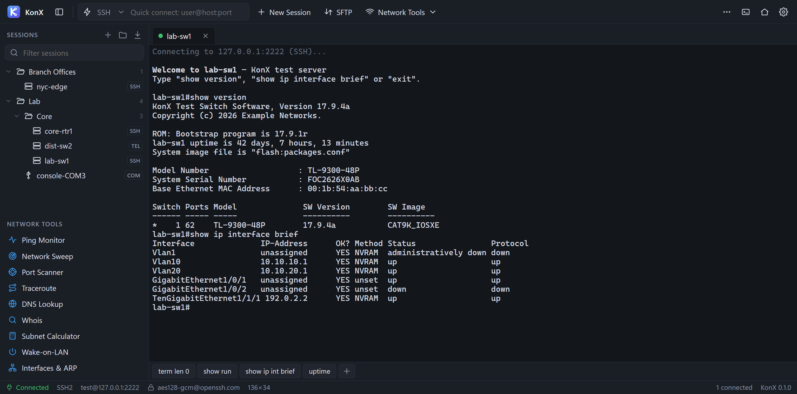
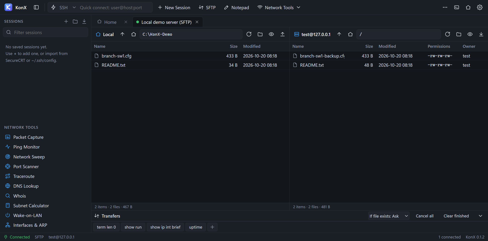
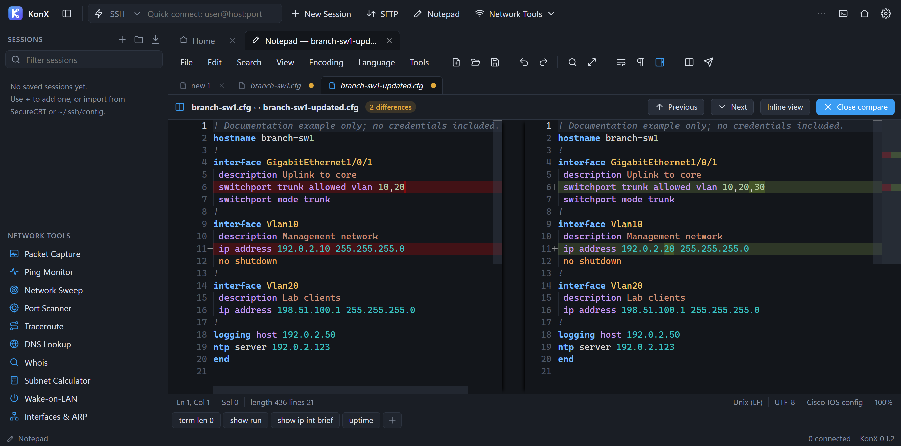
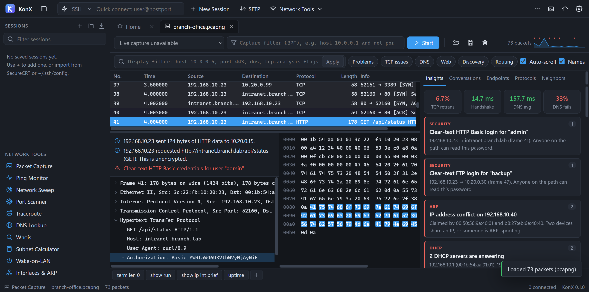

# KonX User Guide

Version 0.33.0 adds **Split screen**, **Single view** and **Pop out** shortcuts above the tabs, plus smaller × controls inside each Home section panel. See [Split screen and separate windows](#split-screen-and-separate-windows) and the [release notes](releases/0.33.0.md).

Version 0.30.0 adds **Ion Storm**, **Solar Flare**, **Aurora Flux**, **Hyperdrive**, and **Ghost Circuit** animated themes. All 18 application themes remain available. See [Appearance and motion](#appearance-and-motion) and the [theme guide](THEMES.md).

Version 0.27.1 renames the contextual assistant to **KonX-AI** and improves encrypted provider-key management. See the [KonX-AI guide](KONX_AI.md), [provider setup](AI_KNOWLEDGE_GUIDE.md#connect-a-provider), and [release validation](releases/0.27.1.md).

This guide covers KonX 0.33.0 for Windows x64. KonX combines terminal sessions, SFTP, a text editor, packet capture, security assessments, wireless diagnostics, and AI-assisted troubleshooting in one application. The [Security Suite](SECURITY_SUITE.md) and [Wi-Fi/Mist tools](WIRELESS_MIST_GUIDE.md) require 0.3.0 or later.

Version 0.27.0 adds reviewed diagnostics, undoable editor replacements and saved answer notes to KonX-AI. See the [KonX-AI guide](KONX_AI.md) and [release validation](releases/0.27.0.md).

Version 0.26.0 adds device, topology, event, site, incident, runbook and change-validation evidence to KonX-AI. See the [KonX-AI guide](KONX_AI.md#investigation-evidence) and [release validation](releases/0.26.0.md).

Version 0.25.0 adds packet, readable stream, SIP/RTP, capture comparison, security and wireless evidence to KonX-AI. See the [KonX-AI guide](KONX_AI.md#traffic-and-wireless-evidence) and [release validation](releases/0.25.0.md).

Version 0.24.0 adds explicit terminal text, connection diagnostics, SFTP metadata, and editor selections to [KonX-AI](KONX_AI.md#workspace-evidence). See [release validation](releases/0.24.0.md).

Version 0.23.0 adds [KonX-AI](KONX_AI.md): local conversations beside your work, immutable evidence, exact request review, explicit provider testing, and basic network tool context. See [release validation](releases/0.23.0.md).

Version 0.22.1 repairs AI context preparation and protects unsaved AI input. See [AI & Knowledge](AI_KNOWLEDGE_GUIDE.md) and [release validation](releases/0.22.1.md).

Version 0.22.0 adds [Guided Change Validation](CHANGE_VALIDATION.md): saved maintenance plans, before/after evidence, manual acknowledgment, explicit decisions, and complete JSON/HTML or incident reports. No workflow phase connects or changes device configuration. See the [release notes](releases/0.22.0.md).

Version 0.21.0 adds [Live Events](EVENTS.md): explicitly started UDP syslog and SNMP trap receivers with filters, readable details, incident attachments, and reviewed JSON/text exports. See the [release notes](releases/0.21.0.md).

Version 0.20.0 adds [Visual Topology](TOPOLOGY.md): clickable maps from observed CDP/LLDP neighbors, recorded interface state, and candidate MAC/IP paths. Open it from Device Inspector, a saved snapshot, or Network Tools. See the [release notes](releases/0.20.0.md).

Version 0.19.0 adds [Saved Site Workspaces](SITE_WORKSPACES.md): retain grouped session references, terminal/SFTP panel arrangements, notes, capture paths, and incident links. Opening a workspace restores context and keeps connection actions explicit. See the [release notes](releases/0.19.0.md).

Version 0.4.0 adds [AI & Knowledge](AI_KNOWLEDGE_GUIDE.md): provider API keys, explanations of selected tool output, and an offline reference library backed by a background SQLite vector index. Older 0.3.0 builds do not include this feature.

Version 0.5.0 adds six animated application themes, with a compact top header and effects behind terminal and editor output. Classic Dark and Light application themes and the existing terminal schemes remain available. See [Appearance and motion](#appearance-and-motion).

Version 0.8.0 adds [Device Snapshots](DEVICE_SNAPSHOTS.md): named local history, optional configuration/route collection, and before/after change checks. [Device Inspector](DEVICE_INSPECTOR.md), introduced in 0.7.0, remains available. See [Updating KonX](UPDATING.md) and the [release notes](releases/0.8.0.md).

Version 0.9.0 adds [RTP media and audio](RTP_MEDIA.md). RTP stream analysis, clickable jitter and packet evidence, G.711 playback, WAV export, and a synthetic media demo. See the [release notes](releases/0.9.0.md).

Version 0.10.0 adds [Incident workspaces](INCIDENT_WORKSPACES.md). Local incident workspaces with selected evidence, source timelines, notes, integrity checks, and HTML/JSON reports. See the [release notes](releases/0.10.0.md).

Version 0.11.0 adds [Remote packet capture](REMOTE_CAPTURE.md). Capture bounded traffic from an existing Linux SSH connection, retain verified local packets, and open them in KonX. See the [release notes](releases/0.11.0.md).

Version 0.12.0 adds [Troubleshooting runbooks](RUNBOOKS.md): reviewed diagnostic procedures, typed targets, per-step evidence, and a saved custom runbook library. See the [release notes](releases/0.12.0.md).

Version 0.13.0 adds [Capture comparison](CAPTURE_COMPARISON.md): working/failing capture comparisons with DNS, TCP, and HTTP observations linked to retained source packets. See the [release notes](releases/0.13.0.md).

Version 0.14.0 adds [Workspace layouts](WORKSPACE_LAYOUTS.md). Four new layouts alongside Classic keep color themes independent while arranging existing sessions and tools for different ways of working. See the [release notes](releases/0.14.0.md).

Version 0.15.0 improves [Session management](SESSION_MANAGEMENT.md): clear recent history on Home and save a username and encrypted password together on General when creating a session. See the [release notes](releases/0.15.0.md).

Version 0.15.1 adds a visible [console logging switch](#session-logging) and [SSH compatibility](SSH_COMPATIBILITY.md): a per-session transport choice, OpenSSH/PEM/PKCS#8/PuTTY key loading, and clearer login errors. See the [release notes](releases/0.15.1.md) for supported algorithms and validation limits.

Version 0.15.2 adds a prominent credential-retention checkbox and optional saved passwords in Home Quick Connect. See [Session management](SESSION_MANAGEMENT.md) and the [release notes](releases/0.15.2.md).

Version 0.16.0 adds [Cisco terminal highlighting](CISCO_HIGHLIGHTING.md): automatic error, interface-state, and IP-address colors with a live console switch and saved preferences. See the [release notes](releases/0.16.0.md).

Version 0.16.1 replaces the generic updater filename with KonX and the target version. See [Updating KonX](UPDATING.md#update-filenames-in-windows-prompts) and the [release notes](releases/0.16.1.md).

Version 0.17.0 adds [serial auto baud detection](SERIAL_AUTO_BAUD.md): a saved-session Auto detect choice, Quick Connect support, optional Enter probes, and visible progress. See the [release notes](releases/0.17.0.md).

Version 0.18.0 adds draggable, resizable floating panels, adjustable split dividers, and separate pop-out windows. Right-click an open tab to **Float in workspace** or **Pop out to window**. Use **Dock back** to return it; closing a pop-out with its Windows X also docks it. See [Workspace layouts and windows](WORKSPACE_LAYOUTS.md) and the [release notes](releases/0.18.0.md).

Version 0.18.1 adds **Report a problem** on Home and **Settings → Support**, with an editable local diagnostic report and opt-in error logs. See [Tester support](TESTER_SUPPORT.md) for the reporting workflow, incident-save behavior, and display recovery.

For downloads, build instructions, and project information, see the [README](../README.md) and [GitHub releases](https://github.com/256kMagic/KonX/releases).

## Contents

- [Install, run, and update](#install-run-and-update)
- [Your first SSH connection](#your-first-ssh-connection)
- [Workspace and tabs](#workspace-and-tabs)
- [Saved sessions, folders, and imports](#saved-sessions-folders-and-imports)
- [Connection reference](#connection-reference)
- [Terminal workflow](#terminal-workflow)
- [Cisco terminal highlighting](CISCO_HIGHLIGHTING.md)
- [SFTP file transfer](#sftp-file-transfer)
- [KonX Notepad](#konx-notepad)
- [Packet capture and analysis](#packet-capture-and-analysis)
- [Reassembled streams and readable traffic](#reassembled-streams-and-readable-traffic)
- [SIP calls and signaling ladders](#sip-calls-and-signaling-ladders)
- [Device Inspector and switch-port tracing](DEVICE_INSPECTOR.md)
- [Device snapshots and change checks](DEVICE_SNAPSHOTS.md)
- [RTP media and audio](RTP_MEDIA.md)
- [Incident workspaces](INCIDENT_WORKSPACES.md)
- [Remote packet capture](REMOTE_CAPTURE.md)
- [Troubleshooting runbooks](RUNBOOKS.md)
- [Capture comparison](CAPTURE_COMPARISON.md)
- [Workspace layouts](WORKSPACE_LAYOUTS.md)
- [Themes and terminal colors](THEMES.md)
- [Saved site workspaces](SITE_WORKSPACES.md)
- [Visual topology](TOPOLOGY.md)
- [Live Events: syslog and SNMP traps](EVENTS.md)
- [Guided Change Validation](CHANGE_VALIDATION.md)
- [Session management](SESSION_MANAGEMENT.md)
- [SSH compatibility](SSH_COMPATIBILITY.md)
- [Network tools](#network-tools)
- [Security Suite](SECURITY_SUITE.md)
- [Wi-Fi and Mist/Marvis](WIRELESS_MIST_GUIDE.md)
- [KonX-AI: contextual assistance and reviewed actions](KONX_AI.md)
- [AI provider settings and knowledge library](AI_KNOWLEDGE_GUIDE.md)
- [Settings](#settings)
- [Keyboard reference](#keyboard-reference)
- [Application data and backups](#application-data-and-backups)
- [Troubleshooting](#troubleshooting)
- [Reporting a problem](#reporting-a-problem)

Examples use reserved documentation addresses such as `192.0.2.10`, `198.51.100.20`, and `2001:db8::10`, plus the example domain `example.com`. Replace them with your own authorized hosts. A `localhost` example works only when the corresponding service is running on your computer.

## Install, run, and update

Download a Windows x64 executable from the [0.33.0 release](https://github.com/256kMagic/KonX/releases/tag/v0.33.0).

| Download | Use it when | How to start |
| --- | --- | --- |
| `KonX-Setup-<version>.exe` | You want an installed application with shortcuts | Run setup, choose an installation folder, finish, and open KonX |
| `KonX-<version>-portable.exe` | You want to run the application without its normal installer | Put the executable in a suitable folder and run it |

The portable executable still uses a Windows user profile for settings, saved sessions, and editor recovery. It does **not** automatically place all data beside the executable or make encrypted credentials transferable between computers. See [Application data and backups](#application-data-and-backups).

**Installed 0.6.0 or 0.6.1:** save work and close KonX, then run `KonX-Setup-0.33.0.exe` manually using your existing installation folder and per-user/all-users mode. Do not uninstall KonX or delete its profile first. These older update buttons cannot install their own fix. All-users installations may require Windows administrator approval.

For updates from **installed 0.6.2 or later**, or **portable 0.6.0 or later**:

1. Save local and remote files, finish or cancel transfers, and save any packet captures you want to keep.
2. Disconnect terminal and SFTP sessions, stop running tools, and save or cancel any open Knowledge note.
3. Press **Update KonX** at the top right of the header, or under **Settings → Updates**. On versions before 0.28.0, the shortcut is on Home. KonX checks for a newer public release, downloads the matching installer or portable executable, and verifies its checksum.
4. With no work active, KonX updates and restarts automatically. If work needs attention, the downloaded update stays ready; finish the listed steps and press **Install and restart**. An all-users installation may show a Windows administrator prompt.

From 0.16.1, staged update filenames include KonX and the version being installed. An update launched from an older copy may show `payload.exe` once while installing this fix; future updates use the branded filename. See [Update filenames](UPDATING.md#update-filenames-in-windows-prompts).

Installed copies retain their installation folder and mode. Portable copies retain their filename and location; the containing folder must be writable. Both continue to use the existing Windows profile. No update is applied just because you close KonX, and no release checks run in the background. See [Updating KonX](UPDATING.md) for cancellation, failures, and release preparation.

Version 0.5.0 and earlier do not have the updater. Save your work, close KonX, then run the 0.33.0 installer or replace the portable executable once to obtain the update button. See the [upgrade table](UPDATING.md) for downloads, checksums, and troubleshooting.

Npcap is optional for packet capture; SSH, SFTP, Notepad, and the other tools do not require it. Updating KonX does not install or update Npcap.

## Your first SSH connection

### Connect once

1. On **Home**, leave **Protocol** set to **SSH2**.
2. Enter your server under **Host**, for example `192.0.2.10`.
3. Set **Port** to the server's SSH port, usually `22`.
4. Enter **Username** and optionally **Password**, or let KonX ask when connecting. Leave **Save session and remember login** unchecked for a one-time connection.
5. Click **Connect**.
6. Verify the SSH host fingerprint before accepting it.
7. Answer the password, key passphrase, or keyboard-interactive prompts presented by the server.

The toolbar's quick-connect field is another way to connect. Choose the protocol from the dropdown, press **Alt+Q**, enter `operator@192.0.2.10:22`, and press **Enter**. The protocol selector follows the same dropdown styling as the settings and session forms. This opens a connection without creating a saved session.

To retain a Home Quick Connect login, select **Save session and remember login** before pressing **Connect**. KonX creates a saved session with the username and an encrypted password, then connects. This option supports SSH, Telnet, and SFTP; SFTP creates an SSH session that can also be opened using **Connect SFTP**. A failed save leaves the form available for retry without starting the connection. See [Session management](SESSION_MANAGEMENT.md).

### Verify the server identity

For an unknown server, **New host key** shows the key type and SHA-256 fingerprint. Compare it with a fingerprint supplied through a trusted channel by the server administrator.

| Choice | Result |
| --- | --- |
| **Cancel** | Reject the connection |
| **Accept once** | Continue this connection without storing the fingerprint |
| **Accept & save** | Store the fingerprint for this host and port and continue |

If the fingerprint differs from one already saved, KonX shows **Host key changed** with both fingerprints. Establish why it changed before using **Replace & connect**. A reinstalled server is one possible cause; an intercepted connection is another.

Saved keys are managed under **Settings → Known Hosts**. Removing a key makes KonX ask again on the next connection; removal does not verify the replacement key.

### Save an on-demand connection

Open the connection's terminal or SFTP tab and choose **Save session**. The action is also available from the application tab's right-click menu. Review the filled-in connection details, set **Name** and **Folder**, and choose **Save**. The current connection keeps running.

The same control becomes **Edit saved session** after saving. Use it to update that record; saving again does not create another copy. These edits apply when opening the saved session from Sessions. See [Session management](SESSION_MANAGEMENT.md#save-an-on-demand-connection) for credential handling and recovery after a failed save.

### Save a session

1. Click **+** beside **Sessions**, or choose **New session** on Home.
2. In **General**, set **Name**, **Protocol**, **Hostname or IP**, and **Port**. Under **Login credentials**, enter **Username** and **Password**. Leave **Remember username and password** checked to retain the password encrypted. Username is always saved with the session.
3. For SSH, use **Authentication** to choose the appropriate method:
   - **Password / keyboard-interactive** for passwords and server challenge prompts.
   - **Public key file** for a private-key file and optional passphrase.
   - **SSH agent (Pageant / OpenSSH)** for an available SSH agent. The default Windows connection is the OpenSSH agent pipe; an existing `SSH_AUTH_SOCK` takes precedence.
4. Under **Connection**, keep **SSH transport compatibility** on **Automatic — modern preferred, legacy allowed**, or choose **Modern transport only** if required by your environment.
5. Use **Save** to keep the session, or **Save & Connect** to start it.

Saved passwords and passphrases use Electron's Windows-backed encryption. If secure encryption is unavailable, password saving is disabled; a typed password can still be used once with **Save & Connect**. Unchecking **Remember username and password** uses a typed password once without replacing any previously saved password. The username remains part of the saved session.

When editing, leaving **Password** blank keeps the saved password. Select **Remove saved password** to delete it explicitly. If encryption or saving fails, the populated editor stays open for retry and the previous session remains intact. See [Session management](SESSION_MANAGEMENT.md) for details.

The session dialog stays anchored near the top of the window when you switch panels. Its header and navigation stay in place, while long form content scrolls and the footer actions remain reachable.

Double-click the saved session to connect again. Right-click it for **Edit…**, **Duplicate**, **Connect SFTP**, and related tools. Duplicating a session does not duplicate its saved password or passphrase.



## Workspace and tabs

- The left sidebar contains saved **Sessions** and **Network Tools**. The toolbar's session-manager button shows or hides it; drag its edge to resize it.
- The top toolbar opens **SFTP**, **Notepad**, the tools menu, **Home**, **Settings**, the button bar, and the command window. Hover over an icon for its label.
- Each terminal, SFTP connection, capture, or network tool has an application tab. Notepad has one application tab with its own document tabs inside it.
- Right-click an application tab to rename it, close it, close others, or close all. Terminal tabs also offer cloning, reconnecting, disconnecting, and opening SFTP when available.
- Drag application tabs to rearrange them. **Alt+1** through **Alt+9** selects a tab by position.
- When tabs fill the window, use the arrow buttons or scroll over the tab strip. **Show all tabs** lists every open tab; selecting one brings it into view.
- Background activity preserves your position in the tab strip. Selecting a tab or resizing the workspace reveals the active tab as needed.
- The status bar describes the active view, including connection state and active transfers.

### Split screen and separate windows

Choose **Split screen** above the tabs to place the current view beside another open view in Workbench. Use each pane's dropdown to choose which open tab appears there, and drag the divider to resize the panes. If only one view is open, the other pane stays empty until you open and select another tab. Splitting does not start another connection. Narrow windows stack the panes vertically.

Choose **Pop out** above the tabs to move the active console or tool into its own Windows window. Drag that window's title bar to another monitor, or position it beside another application. **Dock back** returns it to KonX. The live connection stays open; closing the pop-out using the Windows × also docks it back.

Use **Single view** to return from Workbench to one view without closing either tab. See [Workspace layouts and windows](WORKSPACE_LAYOUTS.md#split-screen-shortcut) for shortcuts, resizing and saved-layout behavior.

### Customize Home

Home has six optional sections: **Introduction**, **Quick connect**, **Recent sessions**, **Sessions**, **Network tools**, and **Keyboard**. Use the small × inside the top-right corner of a section panel to hide the entire section. Its heading and contents leave the page.

To bring a section back, open **Home → Customize Home**, select the sections you want, and choose **Save**. **Restore all** selects every checkbox; choose **Save** to apply that choice. **Cancel** leaves your current Home unchanged. **Customize Home** stays available when every section is hidden, and the empty Home page explains how to restore content.

KonX saves these choices in your local profile. They apply when you reopen Home, change workspace layouts, or restart the app. New profiles and upgrades from 0.30.0 or earlier start with every section visible. Hiding a group does not delete saved sessions, clear recent history, close active work, or remove tools from the sidebar or toolbar.

Hiding **Quick connect** clears its entered password. A session save already in progress may still finish, but hiding the form prevents it from opening a connection afterward. Open the saved session from the Sessions sidebar when wanted.

### Disconnect versus close

**Disconnect** ends a terminal connection but keeps its tab and scrollback. Use the tab menu's **Reconnect**, the terminal's reconnect control, or press **Enter** in a disconnected terminal to reconnect.

Clicking a connection tab's **X**, **Ctrl+Shift+W**, or **Ctrl+F4** removes the application tab and closes its terminal connection. It does not delete the saved session in the sidebar. The X hit area was corrected in version 0.1.2.

Closing an SFTP tab cancels its remaining transfers; KonX asks before closing when transfers are active. Closing a capture or running tool stops that work. Save capture packets before closing the capture tab: they are held in memory.

Closing the **Notepad application tab** retains its editor session and recovery copies for reopening. Closing an individual **document tab** asks how to handle unsaved changes. These are different actions.

## Saved sessions, folders, and imports

### Clear recent sessions

On **Home**, press **Clear recent sessions** beside **Recent sessions**. If the group is hidden, restore it through **Customize Home** first. This clears the history immediately and stays cleared after restarting KonX. Saved sessions, their credentials, open connections, your layout, and Quick connect entries remain intact. Connecting a saved session again adds it back to recent history.

### Organize sessions

Use **New folder** beside Sessions to create a folder. A folder's right-click menu supports a new session, subfolder, rename, delete, and **Connect all**. **Connect all** connects sessions directly in that folder; it does not recurse through subfolders.

Drag a session onto a folder to move it. Its **General → Folder** field can also place it at a path such as `Lab/Routers`, or at the top level when empty. Renaming a folder also updates its descendants. Deleting a folder removes the folder hierarchy and moves its sessions to the deleted folder's parent; it does not delete those sessions.

**Filter sessions** matches names, hosts, usernames, folder paths, and serial-port names. Press **Enter** in the filter to connect the first match; **Esc** clears the filter. In the tree, select a session and press **Enter** to connect, **F2** to edit, or **Delete** to delete its saved definition.

### Import from SecureCRT

Choose the import button or **Import from SecureCRT** on Home, then select the SecureCRT **Sessions** directory. KonX reads supported `.ini` files recursively and puts them under a **SecureCRT** folder, preserving the source folder layout.

Supported session information includes SSH, Telnet, Raw TCP, or Serial protocol; host; username; port; selected serial parameters; and certain explicit SSH identity-file settings. SecureCRT's saved passwords, encrypted secrets, and full application configuration are not imported. Review authentication, serial flow control, jump hosts, forwarding, logging, and logon actions after import.

### Import from OpenSSH config

Choose **Import ~/.ssh/config**, then select the desired config file. Imported sessions appear under **SSH config**. The importer reads `Host`, `HostName`, `User`, `Port`, `IdentityFile`, and a limited `ProxyJump` mapping.

This importer is not a full OpenSSH configuration evaluator:

- It creates the first concrete alias from each `Host` block and skips aliases containing `*`, `?`, or `!`.
- It does not apply wildcard-block inheritance, `Include`, `Match`, `ProxyCommand`, or other OpenSSH directives.
- It considers the first comma-separated `ProxyJump` entry and links it only when the alias matches another imported session.
- Repeating an import creates additional session entries; it does not merge them with earlier imports.

Review imported sessions before connecting, especially non-default ports, identity-file paths, and jump hosts.

## Connection reference

### Quick-connect examples

| Input | Connection |
| --- | --- |
| `operator@192.0.2.10:2222` | SSH on port 2222 |
| `ssh://operator@192.0.2.10` | SSH on port 22 |
| `ssh://operator@[2001:db8::10]:2222` | SSH to a bracketed IPv6 address |
| `telnet://192.0.2.10:23` | Telnet |
| `raw://127.0.0.1:9000` | Raw TCP to a local test service |
| `sftp://operator@192.0.2.10:22` | SFTP using password authentication |
| `COM3` | Serial with the quick-connect default of 9600 baud |
| `COM3@115200` | Serial at a fixed 115200 baud |
| `COM3@auto` | Serial with automatic baud detection |

Use a saved session for key authentication, agent authentication, detailed serial settings, a jump host, logon actions, forwarding, or automatic logging. For quick serial connections, the Home form lets you select **Serial**, enter the COM port, and enter a numeric baud rate or `auto`. See [Serial auto baud](SERIAL_AUTO_BAUD.md).

### SSH connection options

**Connection** contains **Jump host (ProxyJump)**, **SSH transport compatibility**, **Keepalive (seconds)**, **Connect timeout (seconds)**, and **Terminal type**. The default terminal type is `xterm-256color`; other options include `xterm`, `vt100`, `vt220`, `linux`, and `ansi`.

**Automatic — modern preferred, legacy allowed** offers modern algorithms first, with legacy choices available when needed and supported by the runtime. It is also the default for existing sessions without a saved choice. **Modern transport only** excludes legacy server host signatures, key exchange, ciphers, and MACs; it does not control the separate user-key signature negotiation. Host fingerprint verification still applies. Unknown stored compatibility values require an explicit choice before connecting.

A jump host must be another saved SSH session. Save the jump session first, then select it in the destination session. KonX authenticates each hop and verifies each server's host key. It supports a bounded chain of jump hosts and rejects excessive nesting; avoid circular references.

Each jump uses its own transport setting. Standalone SFTP uses the selected session's setting; SFTP opened from a terminal reuses its established connection. SSH audits use the same algorithm policy and report the negotiated choices without authenticating or running commands.

### SSH private keys and login prompts

Under **Authentication → Public key file**, select an OpenSSH, PEM, PKCS#8, or PuTTY v2/v3 private key. Supported key algorithms are RSA, ECDSA NIST P-256/P-384/P-521, and Ed25519, with supported encrypted variants. Windows KonX cannot use DSA (`ssh-dss`); SSH 1, FIDO/security-key files, OpenSSH certificates, and Ed448 are outside this release's supported scope. A `.pub` file alone is not a private key. See the [format and encryption details](SSH_COMPATIBILITY.md#supported-private-keys).

KonX reads and unlocks the key before starting the network connection timeout. It converts supported formats in memory without rewriting the selected file. A missing, malformed, unsupported, or still-locked key stops the connection with an error; it is not silently replaced with password authentication. A server can still reject a valid key and offer another authentication method.

Closing or disconnecting a pending login cancels it, including a username/passphrase prompt or a pending jump-host connection. Replies arriving after cancellation or timeout cannot resume the login or save a host fingerprint. Host-key and server authentication prompts during the connection still use the session's connection timeout; allow enough time to review them.

### SSH port forwarding

In **Port Forwarding**, click **Add port forward** and select a type. Forwards start with the SSH terminal connection and stop when it closes. Check the terminal's status messages for bind failures or server rejections.

| Type | Listen endpoint | Destination is reached from |
| --- | --- | --- |
| **Local (-L)** | Your computer | The SSH server |
| **Remote (-R)** | The SSH server | Your computer |
| **Dynamic SOCKS (-D)** | Your computer | The SSH server, using a SOCKS5 client's requested destination |

For a local tunnel, an example row is **Local (-L)**, listen host `127.0.0.1`, listen port `8443`, destination host `198.51.100.20`, destination port `443`. A local application then connects to `127.0.0.1:8443`; the SSH server must be able to reach the destination.

For a dynamic proxy, set a local listen host and port and configure the client application to use SOCKS5 at that endpoint. KonX's SOCKS5 implementation supports CONNECT without proxy authentication. Binding to `127.0.0.1` keeps it local; use a broader listen address only when you intend other computers to reach it. Remote forwarding also depends on the SSH server's forwarding policy.

### Telnet and Raw TCP

Choose **Telnet** or **Raw TCP** under **General → Protocol** and set the host and actual service port. Both quick-connect defaults are port 23; Raw TCP does not infer a protocol-specific port.

Telnet negotiates Telnet terminal options. A saved username and password can answer recognized initial login prompts automatically. **Logon Actions** can handle additional text prompts. Raw TCP sends and receives a plain TCP stream without Telnet negotiation.

Telnet and Raw TCP do not provide SSH's encryption or server identity verification. Use them only where the connection's security properties are appropriate.

### Serial consoles

Choose **Serial**, select or type the COM port, and use the refresh control to list ports. Match the attached device's documented settings:

- Baud: **Auto detect**, or a fixed rate from 1200 through 921600; default 9600.
- Data bits: 5, 6, 7, or 8; default 8.
- Parity: None, Even, Odd, Mark, or Space.
- Stop bits: 1 or 2.
- Flow control: None, RTS/CTS, or XON/XOFF.

With **Auto detect**, KonX listens at common rates and confirms a single readable result before connecting. Enable **Send Enter while detecting** if the console needs Enter to produce output. Click **Cancel** in the progress overlay or choose **Cancel connection** from the tab or terminal menu to stop detection. A silent, ambiguous, or unreadable port produces an explanation without selecting a rate. Detection changes only baud rate and keeps the saved Auto detect preference. See the [serial guide](SERIAL_AUTO_BAUD.md) for limits and troubleshooting.

The serial library is an optional build dependency. If KonX reports **Serial support is not available in this build**, use a build that includes it. Another program holding the COM port can also prevent a connection.

### Logon actions

Each **Logon Actions** row waits for literal text, then sends its reply followed by Enter. Rows run in order after the connection opens. The reply supports `{username}`, `{password}`, and escapes such as `\r` and `\t`. A blank wait field sends after a short delay. A step waiting for unmatched text times out after 30 seconds and stops the sequence.

Use a distinctive prompt fragment and test the sequence on a non-critical session. Do not append `\r` merely to add Enter: the action already appends it. Prefer the `{password}` placeholder to placing a literal password in a logon-action string, since action strings are ordinary session configuration.

## Terminal workflow

### Cisco output colors

KonX automatically highlights recognized Cisco errors, interface up/down states, and IP addresses. Use **Cisco colors** above the console for a live On/Off switch. Save defaults under **Settings → Appearance → Output highlighting**, or override them in a saved session's **Terminal & Log** page. Remote colors, copied text, and log files remain unchanged. See [Cisco terminal highlighting](CISCO_HIGHLIGHTING.md) for examples and supported patterns.

### Copy, paste, search, and links

Open **Settings → Terminal** to choose your clipboard behavior, then **Save**:

- **Automatically copy highlighted text:** copies terminal text when you select it. This is enabled by default; upgrading preserves your existing choice. **Ctrl+Shift+C** or **Ctrl+Insert** still copies explicitly.
- **Paste clipboard on right-click:** pastes clipboard text when you right-click the terminal. Leave it off to open the terminal menu instead. New profiles keep it off; upgrading preserves your previous menu/paste choice.

With both options enabled, drag to highlight terminal text, release the mouse, then right-click to paste it. Double-click and triple-click selection remain available. Both preferences are saved for future launches and apply to floating and popped-out terminals.

Paste shortcuts remain **Ctrl+Shift+V**, **Shift+Insert**, and middle-click.

With **Confirm before pasting multiple lines** enabled, KonX previews a multi-line paste and asks before sending it. A pasted newline can execute a command on the remote device, so check the target terminal and text before accepting.

Use **Ctrl+Shift+F** for terminal scrollback search. **Enter** finds the next match, **Shift+Enter** the previous one, and **Esc** closes the search bar. **Shift+Page Up/Down** scrolls the terminal history. **Ctrl+=**, **Ctrl+-**, and **Ctrl+0** adjust or reset terminal zoom. **Ctrl+click** a detected web link to open it in the default browser.

The context menu also offers **Select All**, **Clear Scrollback**, **Open scrollback in Notepad**, and **Send Break** for Telnet or Serial. Opening scrollback in Notepad creates an editable copy; save it to retain it as a file.

### Session logging

Click **Log to text file** above an SSH, Telnet, raw TCP, or serial console to start saving its new output. The switch lights green and reads **On** only after the backend successfully opens the file and confirms logging. Click it again to stop. Each console has its own logging state; switching tabs or layouts does not switch another console's logging.

The strip shows the file path. Hover over a shortened path to see it in full, or click the folder button to reveal the file in Explorer. The last confirmed file remains available after stopping or disconnecting, while that tab remains open. In a narrow Workbench or Focus layout, **Hide context** uncovers controls behind the context panel.

The switch is disabled while a start/stop request is pending and whenever the console is disconnected. Failed starts leave it Off and show an error; retry after correcting the folder or permission issue. A later write failure turns it off and reports the failure in the console. Closing or disconnecting the console stops its logger.

The right-click **Start Logging / Stop Logging** action controls the same logger. To start automatically for a saved session, enable **Terminal & Log → Log this session automatically** and optionally choose a filename template and **Timestamp each line**. Clicking the console switch controls the current connection without changing that saved preference.

The default log folder is `Documents\KonX\Logs`, unless **Settings → Terminal → Default log folder** overrides it. Automatically generated filenames end in `.txt` and include the session name, date/time, and a unique suffix. An explicit saved filename/template is preserved, including an existing `.log` extension. Logs append text with terminal control sequences stripped; they record output received after logging starts, not earlier scrollback. To save earlier output, use **Open scrollback in Notepad** and save the document.

| Filename token | Value |
| --- | --- |
| `%S` | Session name |
| `%H` | Host |
| `%Y`, `%M`, `%D` | Year, month, day |
| `%h`, `%m`, `%s` | Hour, minute, second |

For example, `%S_%Y-%M-%D_%h%m%s.txt` makes a timestamped session filename. Explicit templates can resolve to the same file for repeated connections, which then append to it. Terminal logs may contain configuration, command output, or other sensitive text displayed by the server.

### Command buttons and sending to several terminals

Use the toolbar's window-with-buttons icon, labeled **Show button bar** or **Hide button bar**, to toggle reusable command buttons. Its highlighted state reflects whether the bar is shown. Right-click a button to edit, move, or delete it; **+** creates a button. The **Send** value supports `\r` for Enter, `\n` for newline, `\t` for tab, `\e` for Escape, and `\x03` for Ctrl+C. A button that should execute a command usually ends in `\r`.

A normal click sends to the active terminal. **Ctrl+click** sends to every connected terminal tab.

The **Command window** accepts a line and sends it followed by Enter. Enable **Send to all terminal tabs** to broadcast it to every connected terminal; clear the checkbox to send to the active terminal only. **Up/Down** recalls command-window history. Confirm the intended recipients before using either broadcast feature.

## SFTP file transfer

### Connect

- From a connected SSH terminal, click **SFTP** or choose **Open SFTP tab** in its tab menu. This shares the SSH transport: disconnecting or closing that terminal also ends this SFTP connection.
- Right-click a saved SSH session and choose **Connect SFTP** to open a separate SFTP connection.
- With no applicable terminal or saved session selected, the toolbar's **SFTP** button asks for `user@host:port`.

The server must offer the SFTP subsystem. SSH authentication, host-key checks, and saved jump-host configuration apply to separate SFTP connections as well.

### Navigate and transfer

The left pane is **Local** and the right pane is **Remote**. Enter a path in a pane's address field, double-click a folder, or use **Up**, **Home**, and **Refresh**. The eye control toggles hidden files.

To transfer, select files or folders and use the upload/download button or context menu. You can also drag between the local and remote panes in the same SFTP tab. Dropping Windows Explorer files onto the remote pane uploads them; dropping onto a remote folder targets that folder.

**Double-clicking a file transfers it to the opposite pane.** To edit it, use its right-click menu instead.

The **Transfers** panel shows each queued file's destination, progress, speed, and status. Right-click queued or running jobs to **Cancel**. **Clear finished** removes completed entries from the display. Failed or canceled ordinary transfers are not automatically re-queued; select the source and start the transfer again.

| Conflict policy | Behavior |
| --- | --- |
| **Ask** | Show source and existing destination information, then choose Skip or Overwrite |
| **Overwrite** | Replace the existing destination file |
| **Skip** | Keep the existing destination file |
| **Overwrite if newer** | Compare modification times and replace when the source is newer |

An Ask dialog can apply your decision to the remaining files in that transfer. The policy is available in the transfer panel and **Settings → File Transfer**. That settings page also controls the initial local folder, hidden files, and 1–8 simultaneous transfers; the default is 2.

Right-click files to rename or copy paths, and remote files to change permissions. Local deletion uses the Recycle Bin. Remote deletion is permanent, including the contents of selected folders. KonX rejects remote names that cannot be downloaded safely as local filenames; resolve such a name on the server before retrying.



### Edit a remote file

**Edit in KonX Notepad** reads the file into the built-in editor. **Ctrl+S** writes directly back to that remote path. Keep the SFTP tab connected until the save completes. Use **Save As…** for a local copy; this changes that document's destination to the selected local file. Remote files opened this way are limited to 50 MB.

**Edit with default app** downloads a temporary local copy and opens it in Windows' associated application. While the SFTP session remains open, KonX watches the temporary copy and uploads changes after you save. A failed upload shows an error with the local copy's path and retries with increasing delays, up to 30 seconds between attempts.

Wait for **Uploaded …** before relying on a remote edit. Closing its SFTP tab stops the default-app watcher and automatic retries. If the transport is lost, preserve the temporary file, reconnect, and upload it explicitly. This workflow does not merge edits made independently on the server.

## KonX Notepad

Click **Notepad** in the toolbar. It opens a Monaco-based editor with a menu bar, internal document tabs, a document map, and a status bar. Use **File → Open…** for one or more local files, drag files into the editor, or open a local/remote file from SFTP. Local files larger than 200 MB are rejected; large files below that limit may still use substantial memory.

### Save and recover documents

The dot on a document tab marks unsaved changes. **Ctrl+S** saves, **Ctrl+Alt+S** saves under another local filename, and **Ctrl+Shift+S** saves all dirty documents. Edits made while a save is finishing remain marked unsaved until those newer edits are saved too.

Close a document with its own X or **Ctrl+W** to choose **Save**, **Don't save**, or **Cancel** when needed. **Ctrl+Shift+T** reopens the last closed local file.

KonX records the editor session and periodic recovery copies of unsaved text. Reopening Notepad restores available documents and unsaved text. Closing the whole Notepad application tab retains that session rather than prompting for every document. Recovery is a convenience, not a substitute for deliberate saves or backups.

After restart, recovered unsaved remote text becomes an **unsaved copy**. It is not silently reattached to a server. Save it locally, or reconnect SFTP and deliberately apply the text to the intended remote file.

If a local file changes outside KonX, a clean document reloads automatically. A document with unsaved changes asks before reloading. If the file was moved or deleted, KonX reports it and marks the document unsaved so you can recreate it or save elsewhere.

### Encoding, line endings, and languages

The **Encoding** menu supports UTF-8, UTF-8 with BOM, UTF-16 LE/BE with BOM, and ANSI (Windows-1252). BOMs are recognized on open; otherwise valid UTF-8 is used, with Windows-1252 as a fallback. A file that appears binary opens read-only.

**Encode in …** selects the format for the next save. **Reopen as …** reads a local file from disk with the selected decoder, replacing the editor's current text. Save or copy unsaved work before using Reopen. Saving unrepresentable characters as ANSI prompts because they would become `?`; choose UTF-8 to keep them.

Choose **Windows (CR LF)**, **Unix (LF)**, or **Macintosh (CR)** line endings from the Encoding menu or status bar, then save to apply the change. The **Language** menu includes network-config, log, JSON, YAML, shell, and other syntax modes. Changing language controls editing/highlighting; it does not validate a device configuration.

### Editing and searching

- **Edit** provides duplicate/delete/move/join lines, sort alphabetically or by IPv4 address, remove duplicate/empty lines, reverse lines, trim whitespace, convert tabs/spaces, case changes, comments, and read-only mode. Text transforms use the selection when present or the whole document otherwise.
- **Search** provides Find, Replace, next/previous match, selection of occurrences, Go to line, matching brackets, and the editor command palette.
- **View** controls word wrap, whitespace, the document map, folding, and zoom.
- **Search → Find in Files…** searches a chosen local directory with filename wildcards, optional subfolders, match case, whole word, or regular expressions. Click a result to open its file at the matching line. It skips certain system/dependency folders, files over 20 MB, and apparent binary files, and stops at 5,000 matching lines by default. A result represents the first match on a line.

For example, search for `interface` with Filters `*.cfg *.conf *.txt` in a directory of exported configurations. Use **Stop** to end a search and the result panel's X to hide it.

### Compare documents

Open both files, then choose **View → Compare with…**, the compare toolbar button, or a document tab's comparison menu. Choose the other document to show a diff. **Previous** and **Next** move between differences; use **Inline view** or **Side by side** to change the layout. **Close compare** returns to normal editing.



### Text utilities and file hashes

The Notepad **Tools** menu offers:

- JSON formatting/minifying and XML/HTML formatting.
- Base64, URL, and hexadecimal encoding/decoding.
- MD5, SHA-1, SHA-256, and SHA-512 hashes for selected/all text or a file.
- Extracted IPv4 or MAC addresses in a new document.
- **Copy config without secrets**, which creates a sanitized copy using recognizable configuration patterns.
- Line, word, character, and UTF-8 size statistics.

For **Verify a file hash (firmware)…**, choose the file and paste the expected hash. Compare with a hash obtained from a trusted source for that exact file/version. The utility's match result compares bytes; it does not establish who published the file. Review a sanitized document yourself before sharing because patterns cannot identify every possible secret.

### Send text to a terminal

1. Connect the intended terminal first.
2. Open or paste the text into Notepad and optionally select the lines to send.
3. Choose **Tools → Send to terminal…** or its toolbar button.
4. Choose the destination and **Selected lines** or **Whole document**.
5. Adjust **Delay between lines (ms)**; the default is 150 ms. Slow serial devices may need longer.
6. Decide whether to **Skip blank lines and "!" comments** and switch to the terminal.
7. Click **Send**.

Each line is sent followed by Enter. The feature sends commands; it does not wait for command success or parse device prompts. Return to Notepad for the sending status and **Stop** control. Sending stops if the target disconnects.

## Packet capture and analysis

Open **Packet Capture** from the sidebar, tools menu, or Home. You can inspect files without starting live capture. Only capture traffic where you have authorization, and treat packet files as potentially sensitive.



### Choose a capture engine

| Engine | Requirements and behavior |
| --- | --- |
| **Windows built-in capture** | Uses Windows' NDIS capture driver when available. Starting a capture asks for administrator permission through a helper unless KonX is already elevated. No additional packet driver is required. |
| **Npcap** | Optional separately installed driver. Adds a loopback interface and BPF capture filters. Capture permissions depend on the Npcap installation's settings. |

When Npcap is available it is preferred; the interface selector can also list built-in adapters. Pick the group and adapter you intend to use. Built-in **All adapters** is useful when you are unsure which adapter carries the traffic, but may include more traffic and duplicate observations.

If **Install Npcap** is offered, KonX downloads the official installer and checks its digital signature before opening Npcap's own setup. Follow that setup and its license. Npcap has separate licensing and redistribution terms; consult the current [official Npcap site](https://npcap.com/) for your intended use. Alternatively, install it from the official site and retry detection or reopen KonX.

The built-in engine does not provide Npcap-style loopback capture. For traffic between applications on the same machine through loopback, select an appropriate Npcap loopback interface after installing Npcap.

### Start and stop a live capture

1. Select the adapter carrying the traffic.
2. Optionally enter a **Capture filter** before starting.
3. Click **Start** and approve Windows' administrator prompt when using the built-in helper.
4. Reproduce the network activity.
5. Click **Stop**, inspect the packets, and save the capture.

Starting a new capture clears the previous packet list. Save any earlier capture first. Live capture automatically stops at one million retained packets; save it and start a new capture for another interval. The packet count, displayed count, rate chart, and drop statistics help assess what was collected. High traffic rates and large captures can use substantial memory.

### Capture filters versus display filters

A **capture filter** decides what is retained during a live capture. Packets it excludes cannot be recovered later. A **display filter** changes which retained packets are shown and can be changed repeatedly without deleting the other retained packets.

- For **Npcap**, the capture-filter field uses **BPF** syntax, applied by the driver.
- For **Windows built-in capture**, it uses the **KonX display-filter language**, applied as packets arrive; non-matches are not retained by the view.
- The display-filter row always uses KonX's language. It has Wireshark-like fields and shorthand, but is not a complete Wireshark filter implementation.

Example KonX display filters:

| Filter | Shows |
| --- | --- |
| `host 192.0.2.10` | Packets involving that address |
| `src host 192.0.2.10` | Packets from that address |
| `net 192.0.2.0/24 and not port 22` | IPv4 subnet traffic except port 22 |
| `tcp port 443` | TCP traffic involving port 443 |
| `port 8000-8100` | Traffic in that port range |
| `dns or mdns or llmnr` | Name-resolution traffic |
| `tcp.analysis.flags or rst` | Annotated TCP issues or resets |
| `http.host contains "example"` | Decoded HTTP host values containing the text |
| `ip.addr == 192.0.2.10 && tcp.port == 443` | Field-based address and TCP-port match |
| `"example"` | Free-text search |
| `tcp.stream == 0` | A numbered TCP conversation |

Combine conditions with `and`/`&&`, `or`/`||`, `not`/`!`, and parentheses. Comparisons include `==`, `!=`, `>`, `<`, `>=`, `<=`, `contains`, and `matches`. Enter a filter and press **Enter** or **Apply**; **Esc** clears it. An invalid filter is marked with an error. The **Problems**, **TCP issues**, **DNS**, **Web**, **Discovery**, and **Routing** buttons apply useful starting filters.

### Open and save capture files

Use the folder button or drop a capture file into the view. Supported inputs include classic `.pcap`, `.pcapng`, `.cap`, `.dmp`, and supported Windows `.etl` packet traces. The input file-size limit is 1 GB. PCAP/PCAPNG import also stops at 1,000,000 packets or 256 MiB of captured packet bytes and reports the retained prefix and coverage warnings. Opening a file stops any live capture in that tab before replacing its data.

Windows ETL support reads NDIS packet traces such as those recorded with `netsh trace ... capture=yes`. Arbitrary ETL event logs and `pktmon` ETL files are not supported by this importer. A trace without captured packet events cannot be analyzed as a packet capture.

Use **Open sample** when it is offered in the capture notice, or open the repository's [branch-office sample](../assets/samples/branch-office.pcapng) through the file button. The sample lets you explore decoding and insights without collecting live traffic.

The save button offers **Save all packets** and, when a filter reduces the list, **Save displayed packets**. Both write `.pcapng`. Displayed-only export is useful for isolating a conversation, but excludes all hidden packets from the new file. Captures are not automatically saved when you close the tab.

### Read packets, insights, and conversations

Select a packet to view its plain-language explanation, protocol tree, and hex bytes. Click decoded tree fields to inspect the related bytes; right-click fields or packet rows for copying and filters.

Scrolling up during a live capture or navigating packets with the keyboard pauses **Auto-scroll** and clears its checkbox. Check it again to jump to the newest packets and resume following incoming traffic.

The right-side tabs summarize the retained capture:

| Tab | Use |
| --- | --- |
| **Insights** | Plain-language observations and detected conditions; click a linked insight to filter related packets |
| **Conversations** | TCP/UDP pairs with traffic totals; open or right-click a row to follow/filter it |
| **Endpoints** | Addresses and transmitted/received traffic totals |
| **Protocols** | Protocol packet counts and byte totals |
| **Neighbors** | Decoded network discovery information when present |

Insights are heuristic observations from the packets available in this capture. Missing packets, asymmetric capture, offloading, and encrypted payloads can limit interpretation. Verify a suspected problem against device state and the capture location. **Names** displays names learned from capture analysis; it does not make encrypted application payloads readable.

### Reassembled streams and readable traffic

Right-click a TCP/UDP packet and choose **Follow … stream**, or use a conversation row. The window opens a snapshot of the retained packets, using distinct colors for the two directions. Close and reopen it to include packets that arrived later:

- **Readable** reconstructs supported HTTP/1 messages across TCP packets. It shows paired requests and responses when the capture provides sufficient context, headers, trailers, formatted JSON and other text bodies. Search matches start lines, headers, and the retained text previews.
- **Text** and **Hex** show reconstructed payload bytes for TCP and observed UDP datagrams, grouped by direction in sequence order. Their previews are limited to the first 256 KiB and 200 blocks; a visible notice identifies truncation. Search in these views applies to that preview.
- **Packet buttons** return to the corresponding original packet and filter its stream. **Filter this stream** applies the filter without selecting a packet.
- **Save body** opens Save As for a complete, unambiguous decoded HTTP body. Chunk framing is removed, and supported gzip/deflate content is decompressed. Captured HTML remains inert text in the viewer. The suggested filename never chooses the save destination.
- **Copy visible text** copies the rendered conversation preview, including displayed warnings. Save the original capture separately when you need all packet evidence.

TCP data is ordered by sequence number; out-of-order segments are placed in sequence and repeated bytes are deduplicated. The original packet references remain available, including retransmission evidence. UDP datagrams retain their individual boundaries. Missing TCP bytes appear as separate notices and never become application data. Conflicting retransmissions retain the first observed bytes and are marked ambiguous. HTTP parsing stops at a missing-data boundary, and bodies affected by conflicts, truncation, unsupported encodings or incomplete framing cannot be saved as complete.

The HTTP reader currently supports HTTP/1.0 and HTTP/1.1, not HTTP/2, QUIC, TLS/SSH decryption, or network-layer IP fragment reassembly. Without enough captured request context, responses remain unpaired and their body framing may be provisional. A close-delimited response requires a captured orderly FIN before its body can be treated as complete.

Reconstruction is bounded: up to 50,000 packets and 16 MiB of observed payload per stream, with additional sequence-span and work limits. HTTP parsing retains up to 200 messages, 64 KiB of headers per message, 8 MiB per wire body, and 16 MiB of decoded bodies in total. Text body previews retain up to 128 KiB before formatting. Reaching a limit produces a visible warning and prevents incomplete output from being represented as complete; the original capture remains available.

### SIP calls and signaling ladders

Open **Packet Capture → SIP Calls** after loading a capture or collecting traffic. The view examines a snapshot of all retained packets, including packets hidden by the current display filter. It groups observed SIP signaling across UDP/TCP conversations by Call-ID. Close and reopen it to include packets that arrived later.

1. Search the call list by Call-ID, parties, outcome, or method, then select a call.
2. Read the signaling ladder from top to bottom. Endpoint lanes and message arrows show the observed request/response sequence. Paging controls expose additional calls, messages, and endpoints.
3. Select an arrow to inspect the captured SIP headers and body, CSeq, dialog tags, retransmission markings, and warnings. Setup time, duration, and outcome describe the signaling that was captured; missing or ambiguous messages can leave them unknown. Missing capture timestamps also leave the affected timing unknown.
4. Click a **Source packets** button to return to an original packet. This pauses Auto-scroll and clears the display filter if necessary to reveal that packet.

On a wide window, the ladder and selected message appear side by side. Each pane scrolls independently; narrower windows stack the details beneath the ladder. Tagged dialog branches remain separate, and an authentication challenge such as 401 or 407 does not by itself prove that the call failed. Retransmissions stay visible in the ladder; an incomplete message or uncertain retransmission classification carries a note.

For a complete, unambiguous SIP body with an SDP content type, the message details include the session, connection address, timing, and media sections. Media details show ports, transport, direction, codec declarations, format parameters, and explicit RTCP settings. Connection and direction sources identify media overrides, inherited session values, or the SDP default. Port-zero media is marked disabled; dynamic payload IDs without an `rtpmap` declaration remain unmapped. Raw attributes remain available for inspection.

These SDP details describe what the selected message advertises. They do not establish the negotiated codec, successful media delivery, or audio quality. The view supports **plaintext SIP over UDP and TCP**. Use **RTP Media** for supported unencrypted RTP analysis, G.711 playback, and WAV export; see the [RTP media guide](RTP_MEDIA.md). SIP over TLS and SRTP remain encrypted; media decryption is unsupported.

The selected call offers two exports:

- **Export call PCAPNG** saves the original source packets associated with its observed signaling. Packet bytes remain intact: a TCP packet shared by multiple SIP messages may also contain signaling from other calls. This is a signaling export, not an RTP/media export or proof that the entire call was captured.
- **Export JSON report** saves the retained call analysis, message details, structured SDP, warnings, and source-packet references. Use the original capture or PCAPNG export when packet bytes are needed.

Both exports open a Save As dialog and use the snapshot from when the SIP view opened. New live packets do not silently change an export while you inspect the call. Exports are limited to 64 MiB; a report can reach its serialization budget sooner because it includes structured detail as well as raw message text.

SIP analysis examines at most 200,000 packets, 256 TCP conversations, and 32 MiB of candidate input. It retains at most 2,000 messages across 1,000 call groups, with limits of 4 MiB per TCP stream, 64 KiB per SIP header block, and 256 KiB per body. The view pages 20 calls, 50 messages, and 8 endpoint lanes at a time. Select an arrow whose endpoints are off-page to reveal the relevant lanes. Visible warnings identify partial results; missing packets, conflicting TCP overlaps, malformed signaling, or limits can prevent complete interpretation. The original retained capture remains the source evidence.

### Try the SIP sample

Download [sip-demo.pcapng](https://github.com/256kMagic/KonX/releases/download/v0.2.0/sip-demo.pcapng) from the 0.2.0 release, or generate the same sample from a source checkout with dependencies installed:

~~~powershell
npm run sample:sip
~~~

Open the downloaded sample, or the generated `user-data/sip-demo.pcapng`, using Packet Capture's folder button, then choose **SIP Calls**. The sample contains 23 synthetic packets and three calls: an ended call through a proxy, a busy call, and a call with an INVITE split across TCP packets. It also includes SDP and a UDP retransmission. No network capture or live call is made by generating the file.

To check the workflow, select the proxy call, click its **200 OK** response to **INVITE**, and inspect the SDP media port and codec declarations. Export its PCAPNG, reopen that file in another Packet Capture tab, and choose **SIP Calls** again. The JSON export preserves the original snapshot's source-packet numbers; reopening an exported capture assigns that new capture its own packet numbers.

## Network tools

Open a tool from Home, the sidebar, or the toolbar's tools menu. Several result tables offer right-click actions for connecting to, pinging, scanning, looking up, or capturing a selected host. Some actions immediately start the selected test. Use scans only against hosts and networks you own or are authorized to test.

### Ping Monitor

Enter one or more hostnames/IPs separated by commas, spaces, or semicolons, then click **Start**. Set **Count** to `0` for continuous monitoring; adjust interval, timeout, and payload size as needed. Results include sent/received counts, loss, minimum/average/maximum RTT, jitter, and recent history. **Stop** ends monitoring; **Export CSV** saves the table.

For a basic local check, use `127.0.0.1`. A successful ping tests ICMP reachability; a failed ping does not alone establish that a host is down because ICMP may be blocked.

### Network Sweep

Enter a CIDR, range, or list, such as `192.0.2.0/28`, `192.0.2.1-10`, or `192.0.2.1,192.0.2.8`. Replace documentation addresses with your actual authorized network before running it. Options include **Resolve names**, **TCP fallback**, **MAC addresses**, timeout, and parallelism.

The sweep reports discovered live hosts, their detection method, and available names/MACs. MAC visibility usually depends on the local ARP cache and network segment. The TTL-based OS label is only a guess. Double-click a result to open a port scan; **Export CSV** saves the sweep. Target expansion is limited to 65,536 entries and supports IPv4 subnets/ranges, single IPs, and hostnames; IPv6 subnet expansion is not supported.

### Port Scanner

Enter targets and ports such as `22,80,443` or `8000-8010`, then click **Scan**. Presets include **Top 100**, **Network gear**, **Web**, **Windows / AD**, **Databases**, **IoT / ICS**, well-known ports, and all ports 1–65535. Adjust timeout and parallelism to suit the network.

This is a **TCP connect** scanner. It reports open, closed, and filtered results; enable **Show closed / filtered** to include those rows. **Grab banners** attempts to collect service information where supported. A service name inferred from a port number is not proof of the actual software. Double-clicking an open SSH or Telnet port can connect; other ports offer related actions. **Export CSV** saves the result table.

### Traceroute

Set **Destination**, **Max hops**, timeout, and optional name resolution, then click **Trace**. KonX displays up to three RTT observations per hop and the command output. Asterisks mean no reply for that probe, which can reflect filtering or rate limiting rather than a broken forwarding path. **Stop** ends the trace.

### DNS Lookup

Enter a name or an IP for reverse lookup. Choose **A**, **AAAA**, **CNAME**, **MX**, **NS**, **TXT**, **SOA**, **SRV**, **CAA**, **All common**, or **OS resolver**. Leave **Server** empty for the default resolver or specify a DNS server. **OS resolver** uses the operating system lookup rather than a custom server. Click **Lookup** and inspect records, TTLs where returned, server, timing, and any errors.

### Whois

Enter a domain, IP, or ASN such as `example.com` or `AS64500`, then click **Lookup**. The tool shows the response from a registration service. Availability and returned detail depend on the service, network access, and registry policy.

### Subnet Calculator

Enter IPv4 CIDR, an IPv4 address plus a mask, or an IPv6 prefix. Examples: `192.0.2.37/26`, `192.0.2.37 255.255.255.192`, and `2001:db8::1/64`.

IPv4 results include network, broadcast, usable range, masks, host counts, binary/hex forms, and a reverse zone. The **Subnetting** control splits an IPv4 network into smaller subnets. IPv6 results include normalized/expanded addresses, prefix range, address count, and /64 count where applicable. The calculator supports IPv6 even though the sweep does not expand IPv6 prefixes.

### Wake-on-LAN

Enter the target MAC, a broadcast address, and UDP port (default 9), then click **Send magic packet**. A success message means the packet was sent, not that the target powered on. The target's firmware/NIC, power state, and network must support Wake-on-LAN. Directed broadcasts across routers require appropriate network configuration.

### Interfaces & ARP

Use **Refresh** to inspect local interfaces, addresses, CIDRs, networks, MACs, and the ARP cache. Right-click an interface for a subnet calculation or sweep. Right-click an ARP entry for host actions; double-clicking an ARP entry opens a port scan. The ARP table is a local cache, not a complete network inventory.

## Settings

Click the gear icon, make changes, and choose **Save**.

| Page | Controls |
| --- | --- |
| **Appearance** | Workspace layout; application theme; Animate theme effects; terminal color scheme, font, size, cursor shape, blink |
| **Terminal** | Scrollback; right-click paste; automatic selection copy; multi-line paste confirmation; remote tab titles; default log folder |
| **File Transfer** | Initial local folder; conflict policy; simultaneous transfers; hidden files |
| **Known Hosts** | Saved SSH host keys and removal |
| **Updates** | Current version and distribution; explicit **Update KonX** check, download, verification, and restart |

Defaults include a dark theme, terminal font size 14, block cursor, 10,000 scrollback lines, automatic selection copy enabled, right-click paste disabled (opens the context menu), multi-line paste confirmation, Ask on SFTP conflicts, and two simultaneous transfers. Per-session color scheme/font size can override terminal defaults in **Terminal & Log**.

### Appearance and motion

In 0.14.0 or later, **Workspace layout** selects the physical arrangement of the app independently of its theme. Choose **Docked Workbench**, **Incident Desk**, **Operations Wall**, **Focus Workspace**, or **Classic** using the structural previews, then **Save**. Existing profiles keep Classic by default. Switching layouts retains open sessions, tools, captures, and drafts; the focused pane remains the command target. See the [workspace layout guide](WORKSPACE_LAYOUTS.md) for pane selection, focus, expansion, and restart behavior.

Open **Settings → Appearance**, choose an **Application theme**, and choose **Save**. In 0.30.0, five new animated themes provide coordinated colors, stronger glow, and distinctive backgrounds:

| Theme | Colors and motion |
| --- | --- |
| **Ion Storm** | Violet and ice blue with branching electrical arcs |
| **Solar Flare** | Amber and copper with a glowing solar corona |
| **Aurora Flux** | Mint and violet with flowing aurora curtains |
| **Hyperdrive** | Ice blue and indigo with a moving starfield |
| **Ghost Circuit** | Mint and amber with pulses along circuit traces |

The five static themes introduced in 0.29.0 remain available:

| Theme | Look |
| --- | --- |
| **Obsidian Gold** | Charcoal surfaces, warm gold accents, and a dark terminal |
| **Arctic Glass** | Cool light surfaces, cobalt accents, and a light terminal |
| **Deep Ocean** | Dark petrol surfaces, seafoam accents, and a dark terminal |
| **Sandstone** | Warm paper surfaces, clay accents, and a light terminal |
| **Crimson Circuit** | Plum-charcoal surfaces, rose-red accents, and a dark terminal |

These themes work with every workspace layout and follow panels into floating and pop-out windows. Theme changes are saved without reconnecting sessions or replacing open documents. Updating does not automatically select a new theme. See [Themes and terminal colors](THEMES.md) for the full workflow and tester checklist.

Existing Dark and Light themes keep the classic appearance. The six animated themes introduced in 0.5.0 remain available:

| Theme | Look |
| --- | --- |
| **Arc Reactor** | Cyan and cobalt with reactor rings and circuit light |
| **Chroma RGB** | Dark surfaces with a moving spectrum of LED colors |
| **Matrix Mainframe** | Green phosphor, binary rain, and terminal scan texture |
| **Synthwave Grid** | Magenta and cyan with a neon sun and perspective grid |
| **Hologram Prism** | Violet and mint with iridescent edges and orbital geometry |
| **Plasma Forge** | Orange and purple with plasma glow and rotating machinery |

The top header stays compact. Decorative effects appear behind terminal and editor output; there is no separate hero banner above the workspace. Tables, forms, and explanations use quieter surfaces for reading.

For any of the 11 animated themes, choose **Pause effects** in the top header to stop theme animation, or clear **Animate theme effects** in **Settings → Appearance**. This preference is saved for your next launch. Choose **Resume effects** to start motion again. Paused themes retain their colors and decorative backgrounds. KonX automatically respects Windows' reduced-motion preference; the header motion button is disabled while that preference is active. The five static themes and classic Dark/Light have no animated effects, so they do not need pausing. Switching to a static theme keeps your saved motion preference for later.

Application themes coordinate the interface and Notepad's palette and background automatically. To coordinate terminal colors and backgrounds too, set **Terminal color scheme → Follow application theme** in **Settings → Appearance** and choose **Save**. This is the default for new profiles; upgrading preserves an existing profile's terminal scheme, so select it explicitly after updating. A saved session's explicit scheme in **Terminal & Log** continues to override the global selection.

Terminal palettes remain independently selectable. Existing schemes such as KonX Dark, Classic, Green Phosphor, Solarized Dark, Monokai, and Light keep their original colors and opaque backgrounds. Choose one of these whenever you want a terminal palette independent of the application theme.

Notepad's wrap/map/whitespace options are managed in its own menu and toolbar. Its language, encoding, and line-ending choices apply to the document. Saved session connection settings are edited from that session rather than the global settings dialog.

## Keyboard reference

Shortcuts depend on the focused view. Notepad has its own document navigation; a terminal needs focus for terminal copy/search shortcuts.

### Application and terminal

| Shortcut | Action |
| --- | --- |
| **Alt+Q** | Focus toolbar quick connect |
| **Alt+1…9** | Select an application tab by position |
| **Ctrl+Tab / Ctrl+Shift+Tab** | Next/previous application tab; within multi-document Notepad, next/previous document |
| **Ctrl+Shift+W / Ctrl+F4** | Close active application tab |
| **Ctrl+Shift+C / Ctrl+Insert** | Copy terminal selection |
| **Ctrl+Shift+V / Shift+Insert** | Paste into terminal |
| **Ctrl+Shift+F** | Find terminal scrollback; Find in Files when editing in Notepad |
| **Ctrl+= / Ctrl+- / Ctrl+0** | Increase/decrease/reset terminal or Notepad zoom |
| **Shift+Page Up / Shift+Page Down** | Scroll terminal history |
| **F12** | Toggle developer tools |

### Sessions and SFTP

| Shortcut | Action |
| --- | --- |
| **Enter** | Connect a selected saved session; in SFTP, open a folder or transfer a file |
| **F2** | Edit a saved session; rename a selected SFTP item |
| **Delete** | Delete a saved session definition; delete selected SFTP items with confirmation |
| **F5** | Refresh the focused SFTP pane |
| **Backspace** | Go up one directory in SFTP |
| **Ctrl+A** | Select all entries in the focused SFTP pane |

### Notepad editor

| Shortcut | Action |
| --- | --- |
| **Ctrl+N / Ctrl+O** | New document / open local files |
| **Ctrl+S / Ctrl+Alt+S / Ctrl+Shift+S** | Save / Save As / Save All |
| **Ctrl+W / Ctrl+Shift+T** | Close document / reopen last closed local file |
| **Ctrl+Page Down / Ctrl+Page Up** | Next/previous document |
| **Ctrl+Z / Ctrl+Y** | Undo / redo |
| **Ctrl+F / Ctrl+H** | Find / replace |
| **F3 / Shift+F3** | Next/previous match |
| **Ctrl+G** | Go to line |
| **Ctrl+D / Ctrl+L** | Duplicate/delete line |
| **Ctrl+Shift+Up / Ctrl+Shift+Down** | Move line up/down |
| **Ctrl+J / Ctrl+Q** | Join lines / toggle comment |
| **Ctrl+U / Ctrl+Shift+U** | Lowercase/uppercase |
| **Alt+click / Shift+Alt+drag** | Multiple cursors / column selection |
| **F1** | Editor command palette |

## Application data and backups

KonX's normal Windows profile is under `%APPDATA%\KonX`. Installed and portable launches use that profile unless a custom `KONX_USERDATA` directory is explicitly supplied. The default log location is separate, under `Documents\KonX\Logs`.

| Profile item | Purpose |
| --- | --- |
| `settings.json` | Appearance, terminal, transfer, button-bar, and Notepad preferences |
| `sessions.json` | Saved sessions, folders, and encrypted secret values |
| `known_hosts.json` | Accepted SSH fingerprints |
| `mist.json` | Mist cloud selection and Windows-encrypted API token (0.3.0+) |
| `ai.json` | AI provider/model settings and Windows-encrypted API keys (0.4.0+) |
| `knowledge/library.sqlite` and SQLite journal files | Offline reference articles, custom notes, chunks, and local vector index (0.4.0+) |
| `copilot-conversations/` | KonX-AI conversations, selected evidence, reviewed requests, answers and action outcomes; the folder name is retained for compatibility |
| `site-workspaces/` | Saved site notes, session references and panel arrangements |
| `device-snapshots/` | Saved device observations and captured command output |
| `incidents/` | Local incident records and retained evidence |
| `runbooks/` | Saved custom diagnostic procedures |
| `change-validation/` | Saved maintenance plans, evidence and recorded decisions |
| `notepad/session.json` | Editor document list and restore information |
| `notepad/backup/*.txt` | UTF-8 recovery text for unsaved editor work |
| Chromium/Electron profile files | UI state such as recent sessions and expanded folders |

To back up the application state, close KonX and copy its whole profile directory to a protected backup location. Back up logs, captures, and files you edited separately. Copying the executable alone does not back up your sessions or editor recovery.

Password/passphrase encryption does not encrypt all application data. Session names/hosts, notes, logon-action strings, logs, capture files, remote-editor temporary copies, and Notepad recovery text may contain sensitive information in ordinary readable form. Protect the profile and artifacts accordingly.

Windows-encrypted secrets are not a portable credential export. After moving a profile to another account or computer, expect to re-enter saved secrets and check key-file paths. There is no complete session/profile export-and-import UI in this release.

For an isolated profile, advanced users can launch from PowerShell with a separate writable folder:

```powershell
$env:KONX_USERDATA = Join-Path $env:LOCALAPPDATA 'KonX-TestProfile'
& '.\KonX-0.33.0-portable.exe'
```

Run this from the folder containing the portable executable. The environment variable applies to that PowerShell process and launches from it; use a normal shortcut or a separate shell for your normal profile. This setting does not make Windows-encrypted credentials portable.

## Troubleshooting

| Symptom | Checks and recovery |
| --- | --- |
| **A connection tab stays after clicking X** | Use version 0.1.2 or newer. **Ctrl+Shift+W** or **Ctrl+F4** closes the active application tab. Verify you are clicking the connection tab's X rather than a saved session or a Notepad document. |
| **A JavaScript error dialog appears** | Copy its exact text before dismissing it, if possible. KonX 0.3.0 also saves startup errors, uncaught main-process JavaScript errors, and unhandled-rejection warnings to `diagnostics/javascript-errors.log` inside the active KonX profile, normally `%APPDATA%\KonX`. The previous log is `javascript-errors.previous.log`. A closed dialog's text can then be recovered from these files. Earlier 0.2.x builds do not include this logging. |
| **SSH times out or is refused** | Check the host, SSH port, reachability, VPN, firewall, and server service. Use Ping/Port Scanner where authorized. Review the session's timeout and jump host. |
| **SSH authentication fails** | Verify username, authentication method, key-file path, key passphrase, and server policy. Check the OpenSSH agent when using the default Windows agent method. Answer keyboard-interactive challenges as requested. |
| **An older SSH device cannot negotiate** | Check **Connection → SSH transport compatibility**. Automatic permits supported legacy SSH 2 transport; Modern transport only excludes it. See the [supported algorithms and limits](SSH_COMPATIBILITY.md). |
| **A private key cannot be loaded** | Read the specific format, passphrase, integrity, or resource-limit error. Select the private file rather than its `.pub` half. Windows DSA, SSH 1, FIDO key files, certificates, and Ed448 are unsupported. See the [key guide](SSH_COMPATIBILITY.md#supported-private-keys). |
| **Unexpected host-key change** | Compare the old and new fingerprints with a trusted administrator. Replace the saved key only after establishing the reason. |
| **Imported sessions behave differently** | Review the limited importer support above. Enter missing credentials, jump-host links, forwards, terminal settings, and actions in the session editor. |
| **Serial port missing or cannot open** | Refresh the list; verify drivers, cable, COM number, and serial parameters; close other programs using the port. Check whether the build includes serial support. |
| **Garbage characters in a serial console** | Match data bits, parity, stop bits, and flow control to the device. Select a known baud or try Auto detect while readable console output is available. See [Serial auto baud](SERIAL_AUTO_BAUD.md). |
| **An SFTP tab closes with its SSH terminal** | This is expected for SFTP opened from that terminal's shared transport. Use saved-session **Connect SFTP** for a separate connection. |
| **SFTP transfer failed** | Check the transfer row's error, destination path/permissions, disk space, and transport. Reconnect if needed, then reselect and re-queue the source. Unsafe local filenames must be renamed on the server. |
| **Remote save failed in Notepad** | Keep the document open and save a local copy if needed. Check whether its original SFTP tab is still connected. Reopening SFTP does not automatically rebind an old remote document; open the remote file again and deliberately transfer your changes. |
| **Default-app remote edit reports retrying** | Keep SFTP open, preserve the local path shown in the error, and wait for **Uploaded …**. If the connection is gone, reconnect and upload that saved local copy manually. |
| **Notepad text looks incorrectly encoded** | Preserve current unsaved work, then use **Encoding → Reopen as …** on the local file. Choose the intended encoding and line endings before saving. |
| **A document is read-only** | Binary-looking files open read-only. Use a suitable binary editor for binary content; the Notepad **Make editable** option does not make binary round-trips lossless. |
| **Live capture unavailable** | Select a supported built-in adapter or install Npcap separately. Check the adapter and any required administrator permission. File analysis remains available without live capture. |
| **Capture shows no packets** | Select the adapter carrying the traffic, check filter syntax, briefly try no capture filter, and reproduce traffic. For localhost traffic, use Npcap loopback capture. |
| **Capture filter rejected** | Use BPF for an Npcap device and KonX filter syntax for a built-in device. The display-filter row always uses KonX syntax. |
| **ETL opens with no captured packets** | Use a supported NDIS trace recorded with packet capture enabled; an arbitrary ETL or pktmon ETL is not accepted. |
| **Readable traffic has gaps or Save body is disabled** | Inspect the message warnings and source packets. Missing bytes, conflicting retransmissions, incomplete framing, unsupported encodings, or resource limits can prevent complete body recovery. Use Text/Hex and save the original capture to preserve the available evidence. |
| **No SIP calls appear** | Confirm the capture contains plaintext SIP over UDP or TCP. SIP over TLS cannot be decoded here. Review the analysis-limit warnings; SIP Calls uses all examined packets, so changing the display filter alone does not reveal additional calls. |
| **A SIP call has unknown timing or incomplete SDP** | Check whether both directions and the beginning/end of the signaling were captured. Inspect source packets and warnings. The tool reports observed messages and advertised SDP, not inferred missing events or negotiated media. |
| **A SIP export includes another call's message** | Original TCP packets can contain multiple SIP messages. The PCAPNG export retains each selected packet intact; the JSON report isolates the selected call's retained analysis. RTP media is not included. |
| **SIP Calls is missing after an update** | Close and reopen the updated application. Check that you launched the new installed/portable version or the source checkout you updated; an older installed copy does not pick up source-code changes. |
| **Insights disagree with another observation** | Check capture placement, missing/dropped packets, offloading, filter exclusions, and whether both directions were captured. Treat analysis as evidence to investigate. |
| **Sweep misses a known device** | ICMP/TCP probes may be blocked; names/MACs may be unavailable off-link. Verify reachability and service ports directly. |
| **Wake-on-LAN sends but the machine stays off** | Check firmware/NIC power options, wired connectivity, target MAC, broadcast selection, and router policy. |

## Reporting a problem

Open a [GitHub issue](https://github.com/256kMagic/KonX/issues) with:

1. KonX version, Windows version, and installed/portable launch type.
2. The view/protocol and exact steps that reproduce the behavior.
3. What you expected and what appeared, including the exact error text.
4. Whether it repeats with a fresh connection or an isolated profile.
5. A minimal sanitized screenshot, configuration example, or capture only when needed.

Remove credentials, private keys, host inventories, personal paths, sensitive command output, and packet payloads before posting publicly. Review redaction yourself even when using **Copy config without secrets**. Developer-tools output from **F12** can help with a reproducible UI failure, but inspect it for sensitive values before sharing it.

JavaScript diagnostic logs are local and contain the application/runtime version, timestamp, error message, and stack trace. They can include file paths or target details from the error. Review them before sharing. No automatic error uploads are performed. The logger observes failures and preserves the original error handling; it does not recover a failed process or diagnose an earlier dismissed error retroactively.
