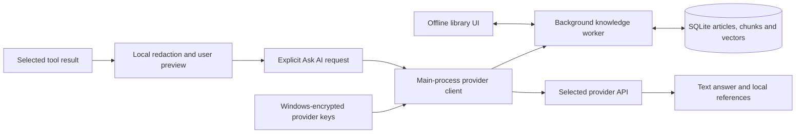

# AI and local knowledge architecture

The assistant helps users understand KonX results and choose further investigations. The first implementation supports OpenAI, Claude, Gemini, Nyquest, and an explicitly configured OpenAI-compatible endpoint. The offline library remains usable when no provider is configured.

The renderer receives key-presence flags, editable non-secret settings, library articles, and bounded reports. It has no direct provider connection or database access. Main-process IPC validates provider settings through the client and routes library operations to one background worker. A configuration revision invalidates stale requests, and changing settings cancels active AI jobs.

The database stores versioned bundled and custom articles, overlapping chunks, normalized 1,024-dimensional TF-IDF vectors, and IDF/index metadata. Startup reconciles the bundle; mutations rebuild the bounded corpus transactionally in the worker. Cosine ranking retrieves a small set of excerpts with titles and provenance. A worker failure is surfaced and preserves the database. SQLite is provided by the packaged Node runtime, avoiding a separately installed service or native extension.

This choice keeps initial setup offline and predictable on Windows. TF-IDF offers lexical relevance rather than neural semantic similarity; unfamiliar phrasing can reduce recall. The bounded corpus and full rebuild are appropriate for the included guides and up to 200 custom notes. Revisit approximate nearest-neighbor indexing, incremental updates, and optional neural embeddings when the corpus or measured retrieval needs justify their additional dependencies and cost. Never silently send library content to an embedding service.

The provider client constructs one bounded request, performs retrieval and redaction, and handles cancellation, response-size limits, incomplete output, and fixed public errors. It grants the model no execution tools. Reports and custom notes are untrusted context, kept separate from assistant instructions. Grounding sources are shown as supplied references; citations are not proof of model accuracy.

No background job reads user sessions, editor files, packet bytes, credentials, or logs. The only background index is the explicitly maintained reference library. User-selected tool snapshots are prepared for review and sent only after context preview, selection, and Ask AI. Questions and answers are not automatically persisted or replayed as chat history.
